# Complete Architectural Dependency Graph

**Date**: 2026-10-29  
**Analysis Method**: Abstract Syntax Tree (AST) static import extraction across all 209 Python files and 15 Jupyter notebooks, complemented by cross-reference scanning.

---

## 1. High-Level Architectural Pipeline

```mermaid
graph TD
    subgraph Layer0 [Level 0: Fundamental Tools & Exceptions]
        T_UTIL["qlbm.tools.utils"]
        T_EXC["qlbm.tools.exceptions"]
    end
    subgraph Layer1 [Level 1: Core Primitives & Base Classes]
        C_BASE["qlbm.components.base (LBMOperator)"]
        C_ADD["qlbm.components.common.adders"]
        C_COMP["qlbm.components.common.comparators"]
        L_BASE["qlbm.lattice.lattices.base (Lattice)"]
        G_SHAPES["qlbm.lattice.geometry.shapes.*"]
    end
    subgraph Layer2 [Level 2: Lattice Models & Velocity Encodings]
        L_AB["qlbm.lattice.lattices.ab_lattice (ABLattice)"]
        L_OH["qlbm.lattice.lattices.oh_lattice (OHLattice)"]
        L_MS["qlbm.lattice.lattices.ms_lattice (MSLattice)"]
        L_ST["qlbm.lattice.lattices.spacetime_lattice"]
        L_LGA["qlbm.lattice.lattices.lqlga_lattice"]
    end
    subgraph Layer3 [Level 3: Algorithm Operators & Physical Solvers]
        OP_AB["qlbm.components.ab (ABStreamingOperator)"]
        OP_MS["qlbm.components.ms (MS-Streaming / Reflections)"]
        OP_ST["qlbm.components.spacetime (SpaceTime Operators)"]
        OP_LGA["qlbm.components.lqlga (LQLGA Operators)"]
        SOLV_D2Q9["qlbm.classical.d2q9 (BGK / Guo forcing)"]
        SOLV_VOF["qlbm.classical.vof + hybrid_vof_lbm"]
        HYB_STEP["qlbm.components.vof.hybrid_stepper"]
    end
    subgraph Layer4 [Level 4: Execution Infrastructure & Runners]
        INF_COMP["qlbm.infra.compiler (QLBMCompiler)"]
        INF_RUN["qlbm.infra.runner (Qiskit / Qulacs Runners)"]
        INF_RES["qlbm.infra.result (Decoding Handlers)"]
    end
    subgraph Layer5 [Level 5: Entry Points, Demos & Experiments]
        E_DAM["demos/simulation/vof_dam_break.py"]
        E_MS["demos/simulation/ms_simulation.ipynb"]
        E_ST["demos/simulation/spacetime_simulation.ipynb"]
        E_LGA["demos/simulation/lqlga_simulation.ipynb"]
        E_AB["demos/simulation/ab_simulation.ipynb"]
        E_EXP_ST["research_experiments/spacetime_reinitialization/*"]
    end
    Layer0 --> Layer1
    Layer1 --> Layer2
    Layer2 --> Layer3
    Layer1 --> Layer3
    Layer2 --> Layer4
    Layer3 --> Layer4
    Layer4 --> Layer5
    Layer3 --> Layer5
```

---

## 2. Core Library Internal Import Matrix

| Module Relative Path | Public Class / Functional Role | Direct Internal Callers | Caller Subsystems |
|---|---|---|---|
| [`qlbm/tools/utils.py`](file:///home/aswa/Research/qlbm/qlbm/tools/utils.py) | KEEP — Shared | **66** | `demos/benchmarks, demos/openqasm, demos/simulation, demos/visualization` |
| [`qlbm/lattice/__init__.py`](file:///home/aswa/Research/qlbm/qlbm/lattice/__init__.py) | KEEP — Shared | **62** | `demos/benchmarks, demos/openqasm, demos/simulation, demos/visualization` |
| [`qlbm/tools/exceptions.py`](file:///home/aswa/Research/qlbm/qlbm/tools/exceptions.py) | KEEP — Shared | **55** | `qlbm/components, qlbm/infra, qlbm/lattice, qlbm/tools` |
| [`qlbm/components/base.py`](file:///home/aswa/Research/qlbm/qlbm/components/base.py) | KEEP — Shared | **41** | `qlbm/components, qlbm/infra` |
| [`qlbm/lattice/spacetime/properties_base.py`](file:///home/aswa/Research/qlbm/qlbm/lattice/spacetime/properties_base.py) | KEEP — Experiment-specific | **36** | `qlbm/components, qlbm/infra, qlbm/lattice, test/unit` |
| [`qlbm/lattice/lattices/spacetime_lattice.py`](file:///home/aswa/Research/qlbm/qlbm/lattice/lattices/spacetime_lattice.py) | KEEP — Experiment-specific | **33** | `demos/simulation, demos/visualization, qlbm/__init__.py, qlbm/components` |
| [`qlbm/lattice/lattices/__init__.py`](file:///home/aswa/Research/qlbm/qlbm/lattice/lattices/__init__.py) | KEEP — Shared | **30** | `demos/simulation, demos/visualization, qlbm/__init__.py, qlbm/components` |
| [`qlbm/lattice/lattices/ab_lattice.py`](file:///home/aswa/Research/qlbm/qlbm/lattice/lattices/ab_lattice.py) | KEEP — Experiment-specific | **30** | `demos/simulation, demos/visualization, qlbm/__init__.py, qlbm/components` |
| [`qlbm/lattice/lattices/lqlga_lattice.py`](file:///home/aswa/Research/qlbm/qlbm/lattice/lattices/lqlga_lattice.py) | KEEP — Experiment-specific | **19** | `demos/simulation, demos/visualization, qlbm/__init__.py, qlbm/components` |
| [`qlbm/classical/d2q9.py`](file:///home/aswa/Research/qlbm/qlbm/classical/d2q9.py) | KEEP — Experiment-specific | **18** | `demos/simulation, demos/visualization, qlbm/classical, qlbm/components` |
| [`qlbm/lattice/geometry/shapes/block.py`](file:///home/aswa/Research/qlbm/qlbm/lattice/geometry/shapes/block.py) | KEEP — Shared | **18** | `qlbm/components, qlbm/lattice, test/unit` |
| [`qlbm/infra/compiler.py`](file:///home/aswa/Research/qlbm/qlbm/infra/compiler.py) | KEEP — Shared | **16** | `demos/benchmarks, qlbm/__init__.py, qlbm/infra, qlbm/lattice` |
| [`qlbm/components/__init__.py`](file:///home/aswa/Research/qlbm/qlbm/components/__init__.py) | KEEP — Shared | **15** | `demos/benchmarks, demos/openqasm, demos/simulation, demos/visualization` |
| [`qlbm/components/ab/encodings.py`](file:///home/aswa/Research/qlbm/qlbm/components/ab/encodings.py) | KEEP — Experiment-specific | **13** | `qlbm/components, qlbm/lattice, test/unit, tests/research` |
| [`qlbm/components/common/__init__.py`](file:///home/aswa/Research/qlbm/qlbm/components/common/__init__.py) | KEEP — Shared | **13** | `demos/benchmarks, demos/simulation, qlbm/components, test/integration` |
| [`qlbm/components/common/primitives.py`](file:///home/aswa/Research/qlbm/qlbm/components/common/primitives.py) | KEEP — Shared | **13** | `qlbm/components, test/integration, test/unit` |
| [`qlbm/infra/__init__.py`](file:///home/aswa/Research/qlbm/qlbm/infra/__init__.py) | KEEP — Shared | **13** | `demos/benchmarks, demos/simulation, demos/visualization, qlbm/__init__.py` |
| [`qlbm/components/ms/__init__.py`](file:///home/aswa/Research/qlbm/qlbm/components/ms/__init__.py) | KEEP — Experiment-specific | **12** | `demos/benchmarks, demos/simulation, demos/visualization, qlbm/__init__.py` |
| [`qlbm/components/spacetime/initial/pointwise.py`](file:///home/aswa/Research/qlbm/qlbm/components/spacetime/initial/pointwise.py) | KEEP — Experiment-specific | **12** | `demos/simulation, demos/visualization, qlbm/components, qlbm/infra` |
| [`qlbm/infra/runner/__init__.py`](file:///home/aswa/Research/qlbm/qlbm/infra/runner/__init__.py) | KEEP — Shared | **12** | `demos/benchmarks, demos/simulation, qlbm/__init__.py, qlbm/infra` |
| [`qlbm/lattice/geometry/shapes/base.py`](file:///home/aswa/Research/qlbm/qlbm/lattice/geometry/shapes/base.py) | KEEP — Shared | **12** | `qlbm/components, qlbm/lattice` |
| [`qlbm/lattice/lattices/base.py`](file:///home/aswa/Research/qlbm/qlbm/lattice/lattices/base.py) | KEEP — Shared | **12** | `qlbm/components, qlbm/infra, qlbm/lattice` |
| [`qlbm/classical/hybrid_vof_lbm.py`](file:///home/aswa/Research/qlbm/qlbm/classical/hybrid_vof_lbm.py) | KEEP — Shared | **11** | `demos/simulation, demos/visualization, qlbm/classical, qlbm/components` |
| [`qlbm/components/spacetime/spacetime.py`](file:///home/aswa/Research/qlbm/qlbm/components/spacetime/spacetime.py) | KEEP — Experiment-specific | **10** | `demos/simulation, demos/visualization, qlbm/components, research_experiments/spacetime_reinitialization` |
| [`qlbm/infra/result/__init__.py`](file:///home/aswa/Research/qlbm/qlbm/infra/result/__init__.py) | KEEP — Shared | **10** | `demos/simulation, demos/visualization, qlbm/__init__.py, qlbm/infra` |

---

## 3. Notebook-to-Source Dependency Map

| Jupyter Notebook | Direct Library Imports | Purpose / Demonstrated Experiment |
|---|---|---|---|
| [`demos/benchmarks/algorithm_scalability.ipynb`](file:///home/aswa/Research/qlbm/demos/benchmarks/algorithm_scalability.ipynb) | `qlbm/components/__init__.py` `qlbm/components/cqlbm.py` `qlbm/infra/__init__.py` `qlbm/infra/compiler.py` `qlbm/lattice/__init__.py` | Common Core Infrastructure |
| [`demos/benchmarks/qiskit_qulacs_comparison.ipynb`](file:///home/aswa/Research/qlbm/demos/benchmarks/qiskit_qulacs_comparison.ipynb) | `qlbm/components/__init__.py` `qlbm/components/common/__init__.py` `qlbm/components/cqlbm.py` `qlbm/components/ms/__init__.py` `qlbm/infra/__init__.py` | Common Core Infrastructure |
| [`demos/benchmarks/statevector_snapshots.ipynb`](file:///home/aswa/Research/qlbm/demos/benchmarks/statevector_snapshots.ipynb) | `qlbm/components/__init__.py` `qlbm/components/common/__init__.py` `qlbm/components/cqlbm.py` `qlbm/components/ms/__init__.py` `qlbm/infra/__init__.py` | Common Core Infrastructure |
| [`demos/simulation/ab_simulation.ipynb`](file:///home/aswa/Research/qlbm/demos/simulation/ab_simulation.ipynb) | `qlbm/components/__init__.py` `qlbm/components/ab/__init__.py` `qlbm/components/common/__init__.py` `qlbm/components/cqlbm.py` `qlbm/infra/__init__.py` | Experiment 7: Amplitude-Based (AB) & Linearization |
| [`demos/simulation/ab_simulation_parallel_bcs.ipynb`](file:///home/aswa/Research/qlbm/demos/simulation/ab_simulation_parallel_bcs.ipynb) | `qlbm/components/__init__.py` `qlbm/components/ab/__init__.py` `qlbm/components/ab/ab.py` `qlbm/components/ab/initial.py` `qlbm/components/common/__init__.py` | Experiment 7: Amplitude-Based (AB) & Linearization |
| [`demos/simulation/ab_simulation_parallel_ics.ipynb`](file:///home/aswa/Research/qlbm/demos/simulation/ab_simulation_parallel_ics.ipynb) | `qlbm/components/__init__.py` `qlbm/components/ab/__init__.py` `qlbm/components/common/__init__.py` `qlbm/components/cqlbm.py` `qlbm/infra/__init__.py` | Experiment 7: Amplitude-Based (AB) & Linearization |
| [`demos/simulation/ab_simulation_y_monomial.ipynb`](file:///home/aswa/Research/qlbm/demos/simulation/ab_simulation_y_monomial.ipynb) | `qlbm/components/__init__.py` `qlbm/components/ab/ab.py` `qlbm/components/ab/initial.py` `qlbm/components/ab/measurement.py` `qlbm/components/common/__init__.py` | Experiment 7: Amplitude-Based (AB) & Linearization |
| [`demos/simulation/lqlga_simulation.ipynb`](file:///home/aswa/Research/qlbm/demos/simulation/lqlga_simulation.ipynb) | `qlbm/components/__init__.py` `qlbm/components/common/__init__.py` `qlbm/components/lqlga/__init__.py` `qlbm/components/lqlga/initial.py` `qlbm/components/lqlga/lqlga.py` | Experiment 6: Lattice Quantum Linear Gas Automaton (LQLGA) |
| [`demos/simulation/ms_simulation.ipynb`](file:///home/aswa/Research/qlbm/demos/simulation/ms_simulation.ipynb) | `qlbm/components/__init__.py` `qlbm/components/common/__init__.py` `qlbm/components/ms/__init__.py` `qlbm/infra/__init__.py` `qlbm/infra/runner/__init__.py` | Experiment 4: Multi-Speed (MS) QLBM |
| [`demos/simulation/spacetime_simulation.ipynb`](file:///home/aswa/Research/qlbm/demos/simulation/spacetime_simulation.ipynb) | `qlbm/components/__init__.py` `qlbm/components/common/__init__.py` `qlbm/components/spacetime/__init__.py` `qlbm/components/spacetime/initial/pointwise.py` `qlbm/components/spacetime/measurement.py` | Experiment 5: Space-Time QLBM & Reinitialization |
| [`demos/visualization/amplitude_components.ipynb`](file:///home/aswa/Research/qlbm/demos/visualization/amplitude_components.ipynb) | `qlbm/components/__init__.py` `qlbm/components/ab/__init__.py` `qlbm/components/ab/streaming.py` `qlbm/components/common/adders.py` `qlbm/components/ms/__init__.py` | Experiment 7: Amplitude-Based (AB) & Linearization |
| [`demos/visualization/flowfields.ipynb`](file:///home/aswa/Research/qlbm/demos/visualization/flowfields.ipynb) | None (self-contained) | Common Core Infrastructure |
| [`demos/visualization/geometry.ipynb`](file:///home/aswa/Research/qlbm/demos/visualization/geometry.ipynb) | `qlbm/infra/__init__.py` `qlbm/infra/result/__init__.py` `qlbm/lattice/__init__.py` `qlbm/lattice/lattices/__init__.py` `qlbm/lattice/lattices/ab_lattice.py` | Common Core Infrastructure |
| [`demos/visualization/lqlga_components.ipynb`](file:///home/aswa/Research/qlbm/demos/visualization/lqlga_components.ipynb) | `qlbm/components/lqlga/collision.py` `qlbm/components/lqlga/initial.py` `qlbm/components/lqlga/lqlga.py` `qlbm/components/lqlga/streaming.py` `qlbm/lattice/lattices/lqlga_lattice.py` | Experiment 6: Lattice Quantum Linear Gas Automaton (LQLGA) |
| [`demos/visualization/spacetime_components.ipynb`](file:///home/aswa/Research/qlbm/demos/visualization/spacetime_components.ipynb) | `qlbm/components/spacetime/__init__.py` `qlbm/components/spacetime/collision/d2q4_old.py` `qlbm/components/spacetime/initial/pointwise.py` `qlbm/components/spacetime/spacetime.py` `qlbm/components/spacetime/streaming.py` | Experiment 5: Space-Time QLBM & Reinitialization |

---

## 4. Test-to-Source Coverage Map

| Test Suite File | Tested Source Modules | Physical / Algorithmic Property Checked |
|---|---|---|---|
| [`test/e2e/test_ab_e2e.py`](file:///home/aswa/Research/qlbm/test/e2e/test_ab_e2e.py) | `qlbm/components/ab/__init__.py` `qlbm/components/ab/ab.py` `qlbm/lattice/__init__.py` `qlbm/lattice/lattices/ab_lattice.py` | Experiment 7: Amplitude-Based (AB) & Linearization |
| [`test/e2e/test_lqlga_e2e.py`](file:///home/aswa/Research/qlbm/test/e2e/test_lqlga_e2e.py) | `qlbm/components/lqlga/__init__.py` `qlbm/components/lqlga/initial.py` `qlbm/components/lqlga/lqlga.py` `qlbm/lattice/__init__.py` | Experiment 6: Lattice Quantum Linear Gas Automaton (LQLGA) |
| [`test/e2e/test_ms_e2e.py`](file:///home/aswa/Research/qlbm/test/e2e/test_ms_e2e.py) | `qlbm/components/ms/__init__.py` `qlbm/components/ms/msqlbm.py` `qlbm/lattice/__init__.py` `qlbm/lattice/lattices/__init__.py` | Experiment 4: Multi-Speed (MS) QLBM |
| [`test/e2e/test_spacetime_e2e.py`](file:///home/aswa/Research/qlbm/test/e2e/test_spacetime_e2e.py) | `qlbm/components/spacetime/__init__.py` `qlbm/components/spacetime/initial/__init__.py` `qlbm/components/spacetime/initial/pointwise.py` `qlbm/components/spacetime/spacetime.py` | Experiment 5: Space-Time QLBM & Reinitialization |
| [`tests/research/test_classical_d2q9.py`](file:///home/aswa/Research/qlbm/tests/research/test_classical_d2q9.py) | `qlbm/classical/d2q9.py` `qlbm/classical/solver.py` | Experiment 3: Classical D2Q9 Hydrodynamic Benchmark |
| [`tests/research/test_cross_paradigm_synthesis.py`](file:///home/aswa/Research/qlbm/tests/research/test_cross_paradigm_synthesis.py) | `qlbm/classical/__init__.py` `qlbm/classical/hybrid_vof_lbm.py` `qlbm/classical/multiphase.py` `qlbm/classical/solver.py` | Experiment 7: Amplitude-Based (AB) & Linearization |
| [`tests/research/test_d2q9_bgk_relaxation.py`](file:///home/aswa/Research/qlbm/tests/research/test_d2q9_bgk_relaxation.py) | `qlbm/classical/d2q9.py` `qlbm/classical/solver.py` | Experiment 3: Classical D2Q9 Hydrodynamic Benchmark |
| [`tests/research/test_d2q9_gravity_forcing.py`](file:///home/aswa/Research/qlbm/tests/research/test_d2q9_gravity_forcing.py) | `qlbm/classical/d2q9.py` `qlbm/classical/solver.py` | Experiment 3: Classical D2Q9 Hydrodynamic Benchmark |
| [`tests/research/test_dam_break_validation.py`](file:///home/aswa/Research/qlbm/tests/research/test_dam_break_validation.py) | `qlbm/classical/d2q9.py` `qlbm/classical/hybrid_vof_lbm.py` `qlbm/classical/vof.py` `qlbm/components/ab/encodings.py` | Experiment 1: Dam-Break VOF-LBM Hybrid |
| [`tests/research/test_free_surface_korner.py`](file:///home/aswa/Research/qlbm/tests/research/test_free_surface_korner.py) | `qlbm/classical/hybrid_vof_lbm.py` `qlbm/classical/vof.py` `qlbm/components/vof/hybrid_stepper.py` | Experiment 1: Dam-Break VOF-LBM Hybrid |
| [`tests/research/test_incompressible_limit.py`](file:///home/aswa/Research/qlbm/tests/research/test_incompressible_limit.py) | `qlbm/classical/d2q9.py` `qlbm/classical/solver.py` | Experiment 3: Classical D2Q9 Hydrodynamic Benchmark |
| [`tests/research/test_laplace_surface_tension.py`](file:///home/aswa/Research/qlbm/tests/research/test_laplace_surface_tension.py) | `qlbm/classical/multiphase.py` | Experiment 2: Shan-Chen Multiphase & Surface Tension |
| [`tests/research/test_ms_boundary_conditions.py`](file:///home/aswa/Research/qlbm/tests/research/test_ms_boundary_conditions.py) | `qlbm/components/ms/__init__.py` `qlbm/components/ms/msqlbm.py` `qlbm/lattice/__init__.py` `qlbm/lattice/lattices/__init__.py` | Experiment 4: Multi-Speed (MS) QLBM |
| [`tests/research/test_ms_register_encoding.py`](file:///home/aswa/Research/qlbm/tests/research/test_ms_register_encoding.py) | `qlbm/lattice/__init__.py` `qlbm/lattice/lattices/__init__.py` `qlbm/tools/exceptions.py` | Experiment 4: Multi-Speed (MS) QLBM |
| [`tests/research/test_ms_streaming_mathematics.py`](file:///home/aswa/Research/qlbm/tests/research/test_ms_streaming_mathematics.py) | `qlbm/components/ms/__init__.py` `qlbm/components/ms/msqlbm.py` `qlbm/components/ms/streaming.py` `qlbm/lattice/__init__.py` | Experiment 4: Multi-Speed (MS) QLBM |
| [`tests/research/test_quantum_collision.py`](file:///home/aswa/Research/qlbm/tests/research/test_quantum_collision.py) | `qlbm/classical/d2q9.py` `qlbm/classical/hybrid_vof_lbm.py` `qlbm/components/vof/collision.py` `qlbm/components/vof/hybrid_stepper.py` | Experiment 7: Amplitude-Based (AB) & Linearization |
| [`tests/research/test_quantum_vof.py`](file:///home/aswa/Research/qlbm/tests/research/test_quantum_vof.py) | `qlbm/classical/d2q9.py` `qlbm/classical/hybrid_vof_lbm.py` `qlbm/classical/vof.py` `qlbm/components/ab/encodings.py` | Common Core Infrastructure |
| [`tests/research/test_shan_chen.py`](file:///home/aswa/Research/qlbm/tests/research/test_shan_chen.py) | `qlbm/classical/d2q9.py` `qlbm/classical/multiphase.py` | Experiment 2: Shan-Chen Multiphase & Surface Tension |
| [`tests/research/test_vof_lbm_hybrid.py`](file:///home/aswa/Research/qlbm/tests/research/test_vof_lbm_hybrid.py) | `qlbm/classical/d2q9.py` `qlbm/classical/hybrid_vof_lbm.py` `qlbm/classical/vof.py` | Common Core Infrastructure |
| [`tests/research/test_vof_reconstruction.py`](file:///home/aswa/Research/qlbm/tests/research/test_vof_reconstruction.py) | `qlbm/classical/vof.py` | Common Core Infrastructure |
