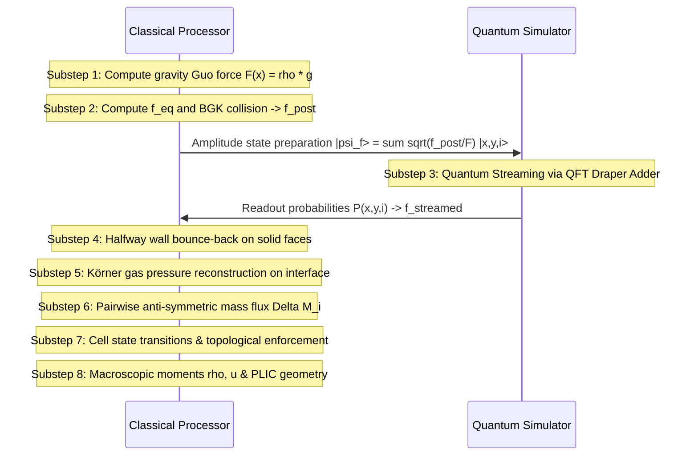

# Mathematical Model and Implementation Specification: Quantum-Circuit Dam-Break Simulator

**Project:** Hybrid Classical–Quantum Lattice Boltzmann Dam-Break Simulation  
**Document:** `docs/research/dam_break/IMPLEMENTATION.md`  
**Date:** 2026-10-23  

---

## 1. Overview and Physical Problem Formulation

The physical problem modeled is the classical **two-phase dam break** (Martin & Moyce 1952), consisting of a rectangular liquid column of width $L_0$ and height $H_0$ initially held at rest behind a vertical dam gate in the lower-left corner of a rectangular computational domain $\Omega = [0, N_x \Delta x] \times [0, N_y \Delta y]$.

At time $t = 0$, the dam gate instantaneously vanishes. Under downward gravitational acceleration $\mathbf{g} = (0, -g)$, the column collapses under its own weight, driving a horizontal surge wave along the floor and developing a downward free-surface recession along the left wall. Solid no-slip boundaries confine the fluid at the floor ($y=0$), left wall ($x=0$), and right wall ($x=N_x-1$), while the top boundary ($y=N_y-1$) opens to an ambient gas reservoir.

---

## 2. Discrete Velocity Model (D2Q9)

The hydrodynamic evolution is governed by the two-dimensional nine-velocity (D2Q9) lattice model.

### 2.1 Velocity Vectors and Ordering

Discrete velocity vectors $\mathbf{c}_i = (c_{ix}, c_{iy})$ for $i \in \{0, \dots, 8\}$ are defined authoritatively as:

$$\mathbf{c}_0 = (0, 0)$$
$$\mathbf{c}_1 = (1, 0), \quad \mathbf{c}_2 = (0, 1), \quad \mathbf{c}_3 = (-1, 0), \quad \mathbf{c}_4 = (0, -1)$$
$$\mathbf{c}_5 = (1, 1), \quad \mathbf{c}_6 = (-1, 1), \quad \mathbf{c}_7 = (-1, -1), \quad \mathbf{c}_8 = (1, -1)$$

### 2.2 Opposite Direction Mapping

For solid wall bounce-back and anti-bounce-back boundary conditions, the opposite index $\bar{i} = \operatorname{OPPOSITE}[i]$ satisfies $\mathbf{c}_{\bar{i}} = -\mathbf{c}_i$:

$$\operatorname{OPPOSITE} = [0, 3, 4, 1, 2, 7, 8, 5, 6]$$

### 2.3 Lattice Weights and Speed of Sound

In lattice units ($\Delta x = 1, \Delta t = 1, c = \Delta x / \Delta t = 1$):
- Lattice speed of sound: $c_s = 1/\sqrt{3}$, hence $c_s^2 = 1/3$.
- Directional weights $w_i$:
  $$w_0 = \frac{4}{9}$$
  $$w_{1,2,3,4} = \frac{1}{9}$$
  $$w_{5,6,7,8} = \frac{1}{36}$$

---

## 3. Hydrodynamic Equations

### 3.1 Equilibrium Distribution

The Maxwell–Boltzmann second-order polynomial equilibrium is:

$$f_i^{\text{eq}}(\rho, \mathbf{u}) = w_i \rho \left[ 1 + \frac{\mathbf{c}_i \cdot \mathbf{u}}{c_s^2} + \frac{(\mathbf{c}_i \cdot \mathbf{u})^2}{2 c_s^4} - \frac{\mathbf{u} \cdot \mathbf{u}}{2 c_s^2} \right]$$

Substituting $c_s^2 = 1/3$:

$$f_i^{\text{eq}}(\rho, \mathbf{u}) = w_i \rho \left[ 1 + 3 (\mathbf{c}_i \cdot \mathbf{u}) + \frac{9}{2} (\mathbf{c}_i \cdot \mathbf{u})^2 - \frac{3}{2} |\mathbf{u}|^2 \right]$$

### 3.2 Macroscopic Moments

Density and momentum are evaluated from discrete populations:

$$\rho(\mathbf{x}, t) = \sum_{i=0}^8 f_i(\mathbf{x}, t)$$

$$\rho \mathbf{u}(\mathbf{x}, t) = \sum_{i=0}^8 f_i(\mathbf{x}, t) \mathbf{c}_i + \frac{\Delta t}{2} \mathbf{F}(\mathbf{x}, t)$$

where $\mathbf{F} = \rho \mathbf{g} = (0, -\rho g)$ is the gravitational body force.

### 3.3 BGK Collision with Guo Forcing

The Bhatnagar–Gross–Krook (BGK) relaxation step with Guo body forcing (Guo, Zheng, Shi, Phys. Rev. E 65, 046308, 2002) is:

$$f_i^*(\mathbf{x}, t) = f_i(\mathbf{x}, t) - \frac{\Delta t}{\tau} \left[ f_i(\mathbf{x}, t) - f_i^{\text{eq}}(\mathbf{x}, t) \right] + \Delta t F_i(\mathbf{x}, t)$$

where the source term $F_i$ preserves 2nd-order accuracy in time:

$$F_i = \left( 1 - \frac{\Delta t}{2\tau} \right) w_i \left[ \frac{\mathbf{c}_i - \mathbf{u}}{c_s^2} + \frac{\mathbf{c}_i \cdot \mathbf{u}}{c_s^4} \mathbf{c}_i \right] \cdot \mathbf{F}$$

Kinematic shear viscosity is related to relaxation time $\tau$ by:

$$\nu = c_s^2 \left( \tau - \frac{1}{2} \right) \Delta t = \frac{2\tau - 1}{6}$$

---

## 4. Free-Surface Volume-of-Fluid (VOF) Formulation

### 4.1 State Decoupling and Classification

The computational domain is partitioned into four discrete cell types based on the local liquid fill fraction $C(\mathbf{x}, t) \in [0, 1]$ and obstacle geometry:

$$\text{State}(\mathbf{x}) = \begin{cases}
\text{SOLID} & \text{if } \mathbf{x} \in \Omega_{\text{solid}} \\
\text{GAS} & \text{if } C(\mathbf{x}) \le \epsilon \\
\text{LIQUID} & \text{if } C(\mathbf{x}) \ge 1 - \epsilon \\
\text{INTERFACE} & \text{otherwise}
\end{cases}$$

where $\epsilon = 10^{-5}$. Hydrodynamic distribution functions are computed exclusively in `LIQUID` and `INTERFACE` cells. Ambient `GAS` cells do not store distributions, enabling simulations at effectively infinite density ratio ($\rho_L / \rho_G = \infty$).

### 4.2 Topological Neighborhood Completeness

To prevent unphysical acoustic velocity shocks across interfaces:

$$\mathcal{N}(\text{LIQUID}) \cap \text{GAS} = \emptyset$$

Any `LIQUID` cell adjacent (in the D2Q9 8-neighborhood) to a `GAS` cell is converted into an `INTERFACE` cell.

### 4.3 Free-Surface Boundary Condition (Körner et al. 2005)

At interface cells adjacent to gas in direction $\mathbf{c}_i$, the incoming distribution function $f_{\bar{i}}$ is missing. It is reconstructed via anti-bounce-back:

$$f_{\bar{i}}(\mathbf{x}_{\text{iface}}, t+\Delta t) = f_i^{\text{eq}}(\rho_{\text{iface}}, \mathbf{u}) + f_{\bar{i}}^{\text{eq}}(\rho_{\text{iface}}, \mathbf{u}) - f_i^*(\mathbf{x}_{\text{iface}}, t)$$

with interface density incorporating the Young–Laplace capillary pressure jump:

$$p_{\text{iface}} = p_{\text{gas}} + \sigma \kappa$$
$$\rho_{\text{iface}} = 1.0 + \frac{p_{\text{iface}}}{c_s^2} = 1.0 + 3(p_{\text{gas}} + \sigma \kappa)$$

where interface curvature $\kappa = \nabla \cdot \hat{\mathbf{n}}$ is evaluated using 2nd-order Youngs normal vectors.

### 4.4 Pairwise Anti-Symmetric Mass Flux Advection

Net mass exchange between adjacent fluid cells across link $i$ is governed by:

$$\Delta M_i(\mathbf{x}, t) = A_i(\mathbf{x}) \cdot \left[ f_{\bar{i}}^*(\mathbf{x} + \mathbf{c}_i \Delta t, t) - f_i^*(\mathbf{x}, t) \right]$$

with symmetric face area:

$$A_i(\mathbf{x}) = A_{\bar{i}}(\mathbf{x} + \mathbf{c}_i) = \frac{1}{2} \left[ C(\mathbf{x}) + C(\mathbf{x} + \mathbf{c}_i) \right]$$

This enforces strict local anti-symmetry:

$$\Delta M_i(\mathbf{x}) \equiv -\Delta M_{\bar{i}}(\mathbf{x} + \mathbf{c}_i)$$

guaranteeing global mass conservation $\sum_{\mathbf{x}} \sum_i \Delta M_i \equiv 0$ down to machine floating-point precision ($< 10^{-14}$).

---

## 5. Quantum-Circuit Formulation

### 5.1 Register Architecture

For grid dimensions $N_x = 2^{n_x}$ and $N_y = 2^{n_y}$:
- Coordinate registers: $|x\rangle$ with $n_x$ qubits, $|y\rangle$ with $n_y$ qubits.
- Velocity register: $|v\rangle$ with $n_v = \lceil \log_2 9 \rceil = 4$ qubits.
- Obstacle ancilla: $|anc\rangle$ with 1 qubit.
- Total register width: $N_{\text{qubits}} = n_x + n_y + 4 + 1$.

### 5.2 Amplitude Encoding and State Preparation

Given a nonnegative post-collision distribution array $f_i^*(\mathbf{x}) \ge 0$, total population mass is:

$$F = \sum_{i=0}^8 \sum_{y=0}^{N_y-1} \sum_{x=0}^{N_x-1} f_i^*(x, y)$$

If $F > 0$, the quantum state is prepared as:

$$|\psi_f\rangle = \sum_{x, y, i} \sqrt{\frac{f_i^*(x, y)}{F}} |x\rangle |y\rangle |i\rangle |0\rangle_{\text{anc}}$$

ensuring exact normalization $\langle\psi_f|\psi_f\rangle = 1.0$.

### 5.3 Quantum Streaming via QFT Draper Adders

The streaming operator $U_{\text{stream}}$ applies conditional coordinate translations in Fourier space:

$$U_{\text{stream}} |x\rangle |y\rangle |i\rangle = |(x + c_{ix}) \bmod N_x\rangle |(y + c_{iy}) \bmod N_y\rangle |i\rangle$$

The circuit implementation:
1. Applies Quantum Fourier Transform (QFT) to spatial registers $|x\rangle$ and $|y\rangle$.
2. Applies controlled phase-shift gates $R_k(\theta)$ conditioned on the binary state of the velocity register $|i\rangle$.
3. Applies inverse QFT ($\text{QFT}^\dagger$) returning spatial coordinates to the computational basis.

### 5.4 State Readout and Reconstruction

Following unitary circuit evolution $|\psi'\rangle = U_{\text{stream}} |\psi_f\rangle$, probabilities are sampled or evaluated via statevector projection:

$$P(x, y, i) = |\langle x, y, i, 0 | \psi'\rangle|^2$$

Classical distributions are reconstructed as:

$$f_i^{\text{streamed}}(x, y) = P(x, y, i) \times F$$

---

## 6. Hybrid Execution Pipeline (`HybridVOFStep`)

---

## 7. Dimensionless Parameters and Physical Scaling

To relate lattice parameters to physical experiments (Martin & Moyce 1952):
- Initial column aspect ratio: $a = H_0 / L_0$.
- Dimensionless time: $T = t \sqrt{\frac{g}{L_0}}$.
- Dimensionless surge front displacement: $Z = \frac{x_{\text{front}}}{L_0}$.
- Dimensionless remaining column height: $\eta = \frac{H(t)}{H_0}$.
- Froude number: $Fr = \frac{U_{\text{max}}}{\sqrt{g L_0}}$.
- Reynolds number: $Re = \frac{U_{\text{max}} L_0}{\nu}$.
